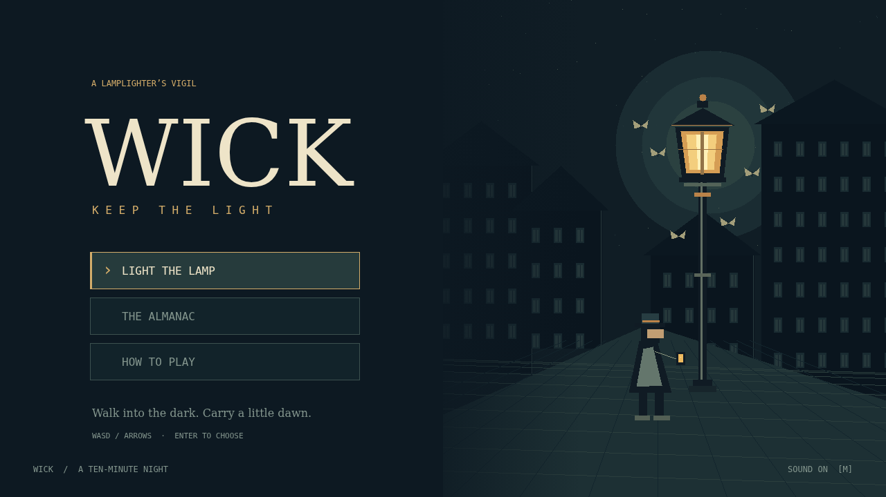

# Wick

One lamplighter, six tools, and ten minutes until dawn. Walk through a city full of things drawn to your light. Your tools fire automatically; collect gems, choose upgrades, and pair a mastered tool with its trinket to transform it in an elite's chest.



Requires Node.js 22 or newer and npm.

```sh
npm ci
npm run dev
```

For a self-contained production site:

```sh
npm run build
npm run preview
```

Serve `dist/` from any static host, including a subdirectory. All sprites, animation frames, effects, icons, WAV cues, and the music score are committed under `assets/`. The build copies them through `public/assets`; it does not generate assets or need the production tools. The optional Python scripts in `scripts/` document the original, one-time art and audio production.

- **WASD / arrows:** move; browse menus.
- **Enter / Space:** choose.
- **Escape:** back or pause.
- **P:** pause / resume.
- **M:** mute.
- **Backtick:** engine diagnostics.

Menus support mouse and touch. Touch devices also receive the engine's directional pad. The Almanac lists all tools, trinkets, creatures, and pickups; use left/right to change its tab and the mouse wheel to scroll.

`npm run typecheck`, `npm run lint`, `npm run format`, and `npm test` check the source. Tests cover fixed ticks, immutable transitions, collision and re-hit timing, effects, progression, evolution, spawn events, debug validation, and end conditions. `src/game.ts` exports the game and typed debug API; the engine owns input, audio, loading, rendering cadence, and diagnostics. Game state contains the simulation and animation history, so rendering and inspection cannot advance play.

The player-facing showcase includes captured screenshots and a three-second recording made with the Simple 2D engine's own draw recorder.
