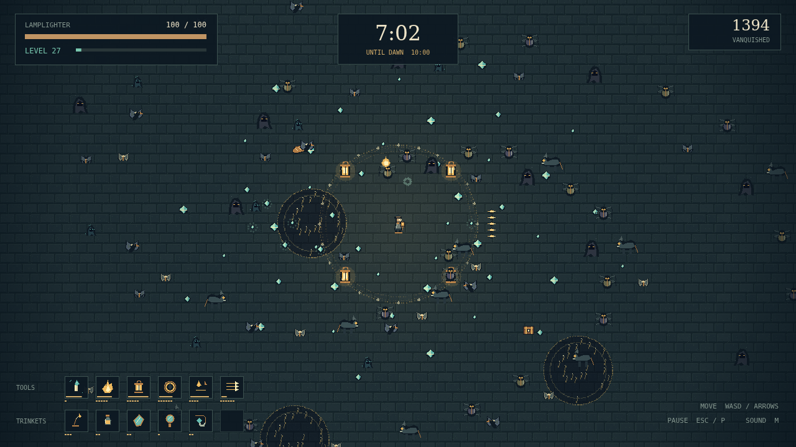

# Wick

The city has gone dark. You have one lamp and ten minutes to keep it burning. Walk the cobblestones while moths gather at the edge of your light. You steer the lamplighter; every tool fires on its own rhythm.

Collect the gems left by the fallen and choose how your light grows. Take a new tool, strengthen an old favorite, or make room for a useful trinket. Six tool slots and six trinket slots turn each small choice into a different way through the crowd.

The night grows teeth. Moths give way to spiders, shades, and hounds. Great winged creatures carry chests: bring a tool at its highest level and its matching trinket, and watch it transform into something brighter.

At nine minutes, the Dark comes for you. Keep moving, find a gap, and carry that last little flame until dawn.

